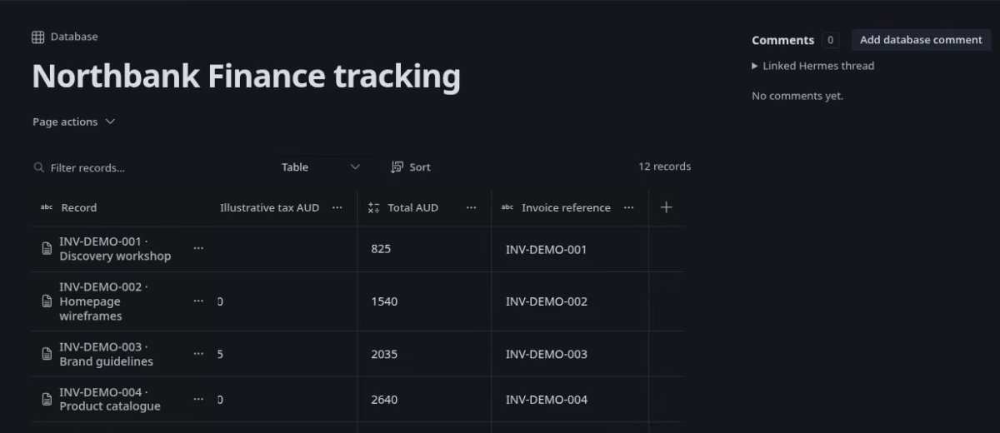

# Hermes Workspace

**Documents, databases and passage-level feedback inside Hermes Desktop.**

Workspace keeps the material you are working on beside your Hermes conversations. Write a brief, organise a chapter outline, or track a project's records in a typed database. Select a passage, leave feedback, and explicitly ask Hermes to address the unresolved comments without handing it unrestricted access to the rest of your workspace.

> **Local, unpublished repair candidate.** See [maintainer repair status and qualification boundaries](docs/LOCAL-MAINTAINER-REPAIR.md). Source/catalog pins and version are unchanged; this working copy is uncommitted.

> **Development preview.** This local candidate retains the full Workspace feature set. The capabilities below describe the implementation. They are not a certificate of native Electron acceptance, successful live-provider editing or catalogue approval. See [Compatibility and qualification](#compatibility-and-qualification).

## Write in place

- Edit page and record titles and rich text directly, with autosave and visible save failures.
- Use Text, Heading 1–3, bold, italic, underline, numbered and bulleted lists, checklists, quotations and code blocks.
- Add external links, links to Workspace items, simple document tables and local image attachments.
- Open **Format text** or use the selected-text toolbar. Copy, cut and paste supported rich content, and undo or redo edits with selection-aware history.
- Choose normal or wide document layout per page or record. Resize the navigation pane without changing document content.
- Recover or discard retained title, body and property drafts explicitly. Workspace also retains unsent comments and replies within their original connection, profile and dataset.

The editor sanitises supported HTML rather than accepting arbitrary scripts or styling. Pasted images are removed; add images through the image control. Word/PDF layout fidelity, embedded live databases and cell-level comments are not included.

### Editor shortcuts

These shortcuts act within their relevant editor or composer. Hermes-owned bindings have first refusal.

| Shortcut | Action |
|---|---|
| `Ctrl+Alt+B` | Bold in the page editor when Hermes has not claimed the chord |
| `Ctrl/Cmd+I`, `Ctrl/Cmd+U` | Italic and underline |
| `Ctrl/Cmd+Z` | Undo |
| `Ctrl/Cmd+Shift+Z` or `Ctrl/Cmd+Y` | Redo |
| `Ctrl/Cmd+Alt+M` | Start a comment on the current selection |
| `Ctrl+Enter` | Submit a new comment from its composer; plain Enter inserts a newline |

The implementation avoids submitting during input-method composition and does not register a permanent global replacement for host shortcuts. This is not a claim of platform-by-platform keyboard qualification.

## Organise and find your work

Create pages, databases and nested folders from Workspace's Home and navigation surfaces. Reopen recent items, move items between folders, and distinguish duplicate names using their location context.

**Expand all** and **Collapse all** operate on the nested folder tree. **Reorder** enables drag handles and Move up/Move down controls, with saved ordering among siblings. Use **Move** to change folders: dragging a reorder handle does not reparent an item or reorder database records.

Workspace search finds titles, document text and text-valued record properties, including computed text values. Results include excerpts, location context and paging. Typing a search does not save or navigate away from the current document; opening a result uses the normal unsaved-edit checks. Search is literal Workspace search, not filesystem search, semantic retrieval or complete conversation-history search.

Save a page or record as a template and create an independent copy, including its supported attachments. Record templates require a compatible database schema. Trash retains items for explicit restoration or permanent deletion; folder and database operations preserve the applicable hierarchy and reference checks.

## Use databases with a document behind each record

A database record has both typed properties and an editable document with its own discussion.

- **Text, number, checkbox, date and single-select** properties cover everyday structured records.
- **Relations** link records in other Workspace databases.
- **Formula** properties calculate bounded, same-row scalar expressions, with dependency checks and visible per-record errors.
- **Table and board views** provide filtering, sorting and grouping by a single-select property. Change a board record's group through its property control, or create a record in a particular lane, including the unassigned lane.
- The top **New** menu offers **New record** and **New property**, alongside labelled inline creation controls. Failed creation and property edits retain their drafts for correction or retry. Run locks also apply to record and schema changes.

For example, a user-created invoice tracker can calculate `col("Hours") * col("Rate")`. Formula helpers include arithmetic, comparisons, conditions, `IF`, `abs`, `round`, `min`, `max`, `len`, `lower`, `upper`, `concat` and `coalesce`. They do not execute arbitrary code, read other rows or provide rollups. An invoice tracker is an example database, not an accounting integration.

## Keep feedback connected to the passage

Select text to start an anchored comment, or leave whole-page, whole-record or whole-database feedback. Numbered passage markers and discussion cards keep separate comments identifiable, including overlapping selections. Wide panes place discussions beside the document; narrow panes reserve space in the reading flow.

Collapsed cards show the author, feedback preview and reply count. Click the preview, card or passage to open the discussion. Outside clicks, Tab navigation and Escape can collapse it without deleting feedback or drafts. Pending actions and confirmation dialogues keep their own interaction state. Hovering a discussion emphasises its passage without editing the document.

Each discussion has separate **Resolve**, **delete comment** and **Revert changes** controls:

- Resolve or reopen feedback using the user's checkbox. An agent reply never resolves a comment automatically.
- Show or hide resolved discussions without renumbering the remaining comments as if they were different threads.
- Delete a discussion after confirmation. Deletion does not delete the prose or undo its edits.
- Revert an eligible agent-changed section using its saved provenance. Unsupported, stale or ambiguous mappings explain why revert is unavailable rather than guessing a larger passage.

Highlights can follow the actual changed passages, including separate changed ranges, rather than colouring unchanged text between them. Detached or uncertain anchors retain their discussion and context instead of silently attaching elsewhere.

Set a Workspace username for your comments and replies, or reset it to `user`. Agent outcomes retain the executing profile's recorded display identity. Eligible avatars come through the matching Hermes profile asset route, with a neutral fallback when unavailable. Human/agent reply presentation follows the recorded origin, not the displayed name. These names and images are attribution, not authentication or edit permission.

## Ask Hermes to address unresolved comments

1. Save your edits and choose **Address comments**.
2. Review the current item and any additional editable items. Additional items start unselected and require approval for this run. A database grant includes its records.
3. Workspace creates or reuses the item's native Hermes conversation. You can also select an eligible conversation from the recent live/stored list or open the linked conversation.
4. Hermes receives the captured document and comment context through the configured Hermes runtime and model provider.
5. Hermes saves validated edits and separate comment outcomes through the scoped Workspace tool. Public native completion hooks determine the final run result; missing or failed completion remains explicit.

Every unresolved current-item comment is included, even if it already has replies. Resolved comments are excluded. Mentions, links, sibling folders and model-written instructions do not widen edit authority.

For local changes, the protocol supports exact, revision-bound replacements. Missing, ambiguous, overlapping or stale targets are rejected without a silent whole-document overwrite fallback. Whole-document replacement remains available for genuinely page-wide work. Structured updates can also change authorised titles, record properties and database schemas. Replies-only outcomes and explanations of partial or impossible work are supported.

**Address comments** uses `workspace_apply` with a plugin-owned one-use call ticket minted by the public originating-turn hook. The handler independently checks captured scope and revocation. A bounded final structured proposal is also supported after positively correlated completion. No provider credentials or model settings are managed by Workspace.

### Stop, Recover, Restore and Revert are different

| Control | Meaning |
|---|---|
| **Stop** | Durably revoke local saves, finish the local run and unlock its items, then request cancellation of the exact native admission when available. Accepted partial work and pre-run Restore remain. Native cancellation can remain unknown. |
| **Recover document** | Explicitly release local editing when native continuity is uncertain. The native result can remain unknown. |
| **Restore a saved version** | Restore whole-item content and applicable typed schema history. This can replace later edits. |
| **Revert changes** | Revert an eligible saved section, preserving unrelated content. Later manual edits require fresh confirmation. A checkpoint retains the pre-revert page and the specifically associated agent responses removed from the live discussion. |

Admitted items are read-only during a run; other unlocked items remain usable. Run state, errors and review messages come from persisted results, not a simulated progress timer. A terminal targeted-edit conflict is reported as **not saved** and releases its locks rather than repeatedly applying the rejected proposal.

## Import, export and back up locally

| Format | Import | Export |
|---|---|---|
| Markdown | Editable page with supported semantics and retained original | Document content; not a complete Workspace backup |
| UTF-8 CSV | Database with text properties | Database values, with formula-like text prefixed for spreadsheet safety |
| Word `.docx` | Supported text, headings, marks, lists, links and tables; retained original | Semantic Word document with supported local raster images |
| PDF | Extracted text in source-page order; retained original | Newly laid-out readable PDF, including supported lists, tables, code/quote styling and local raster images |
| Workspace backup | Validated replacement of the current dataset | Canonical archive of the stored Workspace data graph |

Word export/import handles supported nested list numbering and preformatted code. PDF export handles supported block content and images inside table cells. Conversion is semantic, not a lossless office-document round trip. DOCX drawings and embedded images are not imported into the editable text; the original file is retained. PDF import does not preserve the source's columns, images or formatting, and does not perform OCR. Encrypted PDFs and detected image-only pages are refused. Legacy `.doc` is unsupported.

Converters do not fetch remote images. Supported raster export can use a static frame for GIF/WebP. Inputs, archives, image dimensions and conversion work have operation-specific limits. PDF conversion uses a local child process with a parent timeout and POSIX resource limits where available.

The canonical backup includes items and hierarchy, properties and relations, comments and replies, attachment bytes and originals, templates, Trash, recents and saved recovery/provenance history. It is not a full Hermes-profile backup.

**Before restoring a backup, download a backup of your current Workspace.** Restore validates before replacing the dataset; it does not merge. Native conversation bindings and execution authority are detached. Credentials, Hermes configuration, native conversations, frontend drafts/view preferences and shared-membership catalogues are not restored. If delivery is uncertain, the interface checks the restore receipt instead of automatically repeating the destructive replacement.

## Local storage, privacy and permissions

- The default workspace is private to the selected Hermes profile and is stored under that profile's `plugin-data/workspace/`, outside the plugin installation directory.
- SQLite transactions, revision checks and captured connection/profile/dataset identities protect application writes from stale operations. Local storage is not encryption or isolation from other tools running as the same OS user.
- There is no separate Workspace account service, cloud converter, plugin telemetry service or plugin-managed credential store.
- Explicit native agent work may send authorised document and comment context to your configured model provider. Local storage does not mean offline inference. Hermes owns tool policy and approvals.
- Native thread reads use public `SessionDB.get_session` and `get_compression_lineage` with a read-only connection. Workspace authority, one-use call consumption, effects and receipts share a plugin-owned SQLite transaction. Workspace Stop durably revokes before requesting exact-admission native cancellation. Edits accepted before revocation can remain as accurately reported partial work, with pre-run Restore; physical-click-time native Stop linearisation is not claimed.

### Local shared workspaces and independent executors

The package includes backend primitives for explicit local-profile memberships, editor/read-only roles, membership revocation and transactional private-to-shared moves. It also includes saved executor/source/thread data and standalone UI components.

**These are not a completed sharing or executor-selection experience.** The default router does not configure a shared storage root, the sharing and page-executor components are not mounted by the Desktop entrypoint, and native execution rejects unsupported saved ownership bindings. No cloud collaboration, public sharing links, real-time co-editing, shared-project backup interface or automatic future-profile installation is claimed.

## Compatibility and qualification

The manifest declares Hermes `>=0.23.0`. The renderer checks the installed backend through profile-scoped host APIs before registering Workspace navigation. Default loading respects a backend opt-out; an explicit Desktop On decision can request activation of an already installed package through the host's admitted API. It does not install the plugin into every profile.

This is a development preview submitted for catalogue review. Current submission tracking is [issue #13](https://github.com/kaosjammo/hermes-workspace/issues/13).

Source tests cover editor structure, comments, navigation, typed data, converters, backup/restore and native-authority boundaries. Some native lifecycle tests deliberately use synthetic terminal records. Their presence is not proof that those tests passed on this submission, and synthetic completion is not a successful live-provider run.

The independent documentation audit was static. The local repair candidate builds its Desktop bundle normally from maintained source, with repeated build identity and source/package/dist parity recorded in [maintainer repair status](docs/LOCAL-MAINTAINER-REPAIR.md). Published-snapshot receipts remain historical in [release status](docs/RELEASE-STATUS.md). Same-candidate provider-positive saved editing, active-provider Stop, full restart/compaction/approval lifecycle behaviour, native visual acceptance and macOS/Windows execution require separate evidence. Older catalogue-check totals and earlier demo media are not acceptance receipts for this candidate.

## Build from source

Use Node 26 or newer. From a writable checkout of the repository:

```bash
mkdir -p .local/toolchain
cp package.json package-lock.json .local/toolchain/
npm ci --prefix .local/toolchain --ignore-scripts
node scripts/build.mjs
```

The build writes `desktop/plugin.js` and performs the configured browser-module smoke check. To stage the unified plugin and deterministic archive, choose a fresh output directory:

```bash
python3 scripts/package.py --output .local/dist
```

The package includes the Desktop bundle, authenticated API, Python backend, declared tool/hooks and dependency declarations. Use an isolated environment for dependency preparation and catalogue validation, not a live installation. The historical submitted bundle remains available at source pin `3eeb9986101a3d75c4f9cddc26bb5a3e31bcb9f5`. This unpublished candidate rebuilds the whole Desktop bundle normally from maintained frontend source, including the approved paragraph behaviour. Dependency symlinks retain checkout-relative module labels, and repeated builds must match. No installed or published snapshot was replaced.


## Review and distribution

The catalogue entry targets `dist/workspace`, the generated runtime package. The same pinned repository retains the complete editable source, test corpus and documentation at its root. No documents, profile settings, databases, credentials or native conversation histories are included.

See the [complete production feature audit](docs/PRODUCTION-FEATURES.md), [original detailed register](docs/FEATURE-REGISTER.md), [current release status](docs/RELEASE-STATUS.md) and [third-party notices](THIRD-PARTY-NOTICES.md). The bundled React DOM code carries its complete MIT notice there; Hermes supplies the React singleton and plugin SDK. Workspace's own reuse licence is not selected, and this submission makes no open-source permission claim.

The local PDF conversion child receives an explicit minimal environment: package import path, standard executable path, locale and supported home/temp/platform paths. Provider credentials, proxies and arbitrary Python startup settings are not forwarded. Timeout and POSIX limits are resource bounds, not a sandbox or network-isolation guarantee. Passing automated checks is not catalogue admission.



This earlier-build capture uses fictional records, illustrates the interface only, and is not native acceptance of this pin. [Media provenance](docs/MEDIA.md).


### Tested paragraph feedback behaviour (0.1.2)

Addressed feedback highlights its replacement paragraph, including merged or overlapping passages. Separate discussions keep independent identities and replies. Display recovery never enables an unproven independent revert. The local candidate bundle is a normal source build; the submitted production artifact remains the historical baseline. Native/provider acceptance remains distinct from automated validation.
